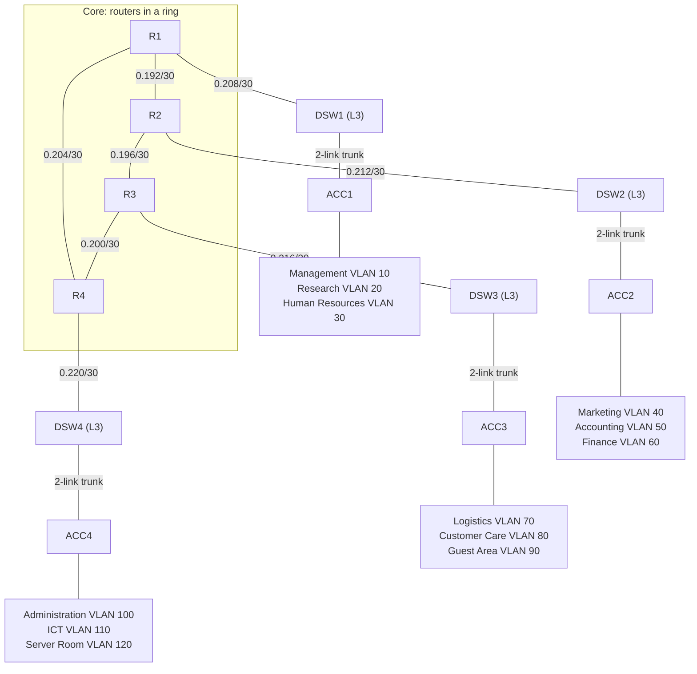

# Four-Storey Office Network: Core, Distribution and Access with OSPF

A Cisco Packet Tracer lab that designs a hierarchical network for a four-storey office with 12 departments. Four routers form an OSPF core ring. Each floor has a multilayer distribution switch that acts as the gateway and DHCP server for its VLANs, and an access switch that connects to it over a 2-link EtherChannel trunk.

## Skills demonstrated

- Three-layer hierarchical design (core, distribution, access) with redundant core paths
- Single-area OSPF across routers and multilayer switches, with passive SVIs
- VLSM subnetting of 192.168.0.0/24 into /28 department subnets and /30 router links
- Inter-VLAN routing with SVIs on Layer 3 switches
- DHCP pools served from the distribution switches
- EtherChannel trunks between access and distribution switches
- SSH v2 remote management on all routers

## Topology




Subnets in the diagram are shown as `0.x`, meaning `192.168.0.x`.

## Addressing summary

| Floor | Department | VLAN | Subnet |
|---|---|---|---|
| 1 | Management | 10 | 192.168.0.0/28 |
| 1 | Research | 20 | 192.168.0.16/28 |
| 1 | Human Resources | 30 | 192.168.0.32/28 |
| 2 | Marketing | 40 | 192.168.0.48/28 |
| 2 | Accounting | 50 | 192.168.0.64/28 |
| 2 | Finance | 60 | 192.168.0.80/28 |
| 3 | Logistics & Supply | 70 | 192.168.0.96/28 |
| 3 | Customer Care | 80 | 192.168.0.112/28 |
| 3 | Guest Area | 90 | 192.168.0.128/28 |
| 4 | Administration | 100 | 192.168.0.144/28 |
| 4 | ICT | 110 | 192.168.0.160/28 |
| 4 | Server Room | 120 | 192.168.0.176/28 |

Router links use /30 subnets from 192.168.0.192 to 192.168.0.223. The full tables, including interface addresses and the access port plan, are in [docs/addressing-and-build-guide.md](docs/addressing-and-build-guide.md).

## Design decisions

- **Why /28 subnets.** Each department is sized for 4 PCs, 2 printers and a gateway, which is 7 addresses. A /29 has only 6 usable addresses, so a /28 is the smallest fit. Twelve /28 subnets use 192 addresses, which leaves 192.168.0.192/26 for the /30 router links. A /27 per department would not fit in a /24.
- **Core ring.** Four routers joined in a ring give every floor two paths to every other floor, so OSPF reroutes if a ring link fails.
- **Layer 3 distribution.** Each floor's multilayer switch holds the SVIs (gateways) and DHCP pools for its three VLANs, and connects to its router over a routed /30 link.
- **EtherChannel trunks.** Each access switch uplinks to its distribution switch over two links bundled into one trunk, giving extra bandwidth and link redundancy.
- **Passive SVIs.** OSPF runs with `passive-interface default` on the distribution switches, so hellos go out only on the router link.
- **Management.** SSH v2 with a local user on all routers.

## Configuration

Device configurations are in [configs/](configs/): `R1` to `R4`, `DSW1` to `DSW4` and `ACC1` to `ACC4`. Passwords are replaced with placeholders. Replace `<ENABLE_SECRET>` and `<ADMIN_PASSWORD>` with your own values if you reproduce the lab.

## Verification

The checklist is in the build guide. Evidence from the lab:

| Check | Evidence |
|---|---|
| OSPF neighbours and routes | `screenshots/ospf.png` |
| EtherChannel and trunk status | `screenshots/etherchannel.png` |
| DHCP leases | `screenshots/dhcp.png` |
| Cross-floor connectivity | `screenshots/ping.png` |
| SSH to a router | `screenshots/ssh.png` |

## Possible improvements

- A second uplink from each distribution switch to a neighbouring floor's router
- A second access switch per floor, so one switch failure doesn't take down a floor
- HSRP with a second distribution switch per floor (needs larger subnets than a /24 allows)
- ACLs to isolate the Guest Area from internal departments
- SSH on the switches, and OSPF authentication

## Repository structure

```
four-storey-office-network/
├── README.md
├── FourStoreyOffice.pkt
├── configs/
├── docs/
│   └── addressing-and-build-guide.md
└── screenshots/
```

## Running the lab

1. Install Cisco Packet Tracer.
2. Open `FourStoreyOffice.pkt`.
3. Wait for the links to turn green, then follow the verification steps in the build guide.

## Author

Ibrahim Iyawa · [GitHub](https://github.com/ibrahimiyawa) · [LinkedIn](https://linkedin.com/in/ibrahim-iyawa-90b729352)
